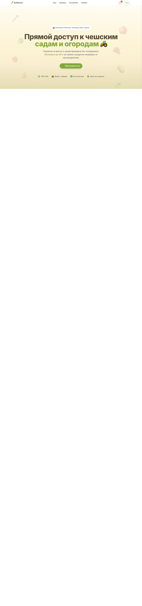
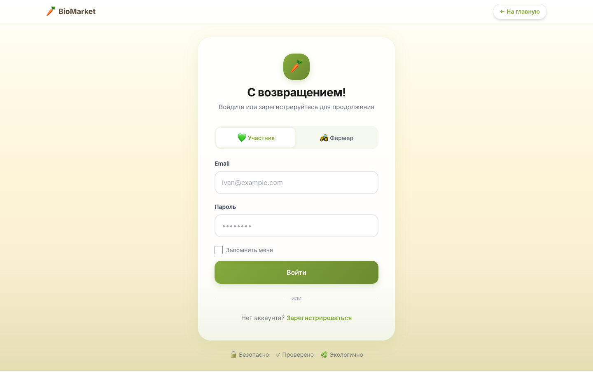
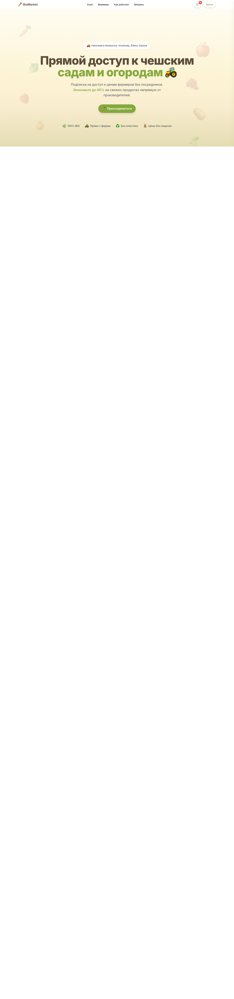
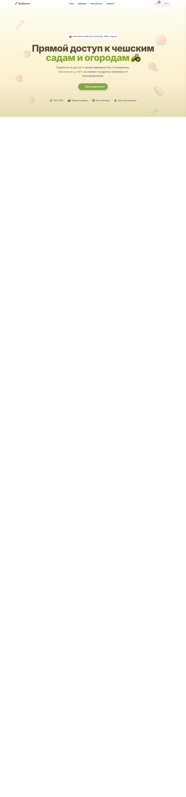
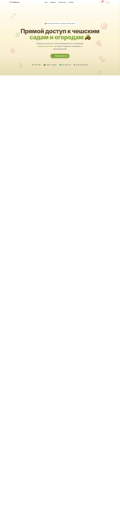
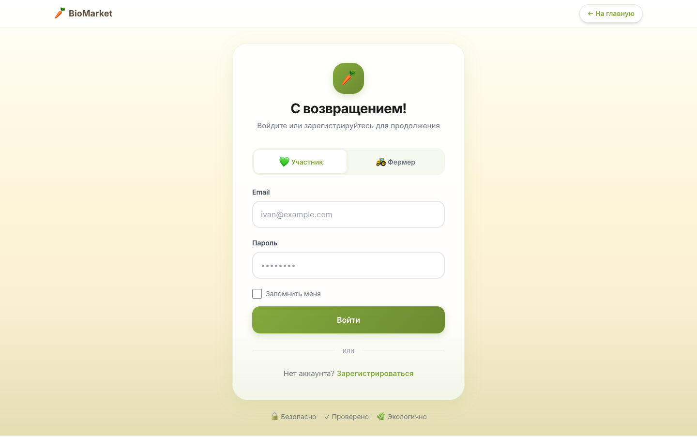

# PlantUp — SaaS For Sale

**Turnkey farm-to-table subscription marketplace for local farms and city food clubs.**

A complete product ready to launch as your own SaaS: branded marketing site, member / farmer / admin dashboards, Comgate payments, Cloudinary media, and eco positioning (10% of profits → tree planting).

## Live preview (local)

```bash
cd "/Users/temirlankakishev/Project/PlantUp SaaS For Sale"
python3 -m http.server 8080
# open http://localhost:8080
```

| Page | Path |
|------|------|
| **Sales deck** | [`index.html`](./index.html) |
| **Screen hub** | [`demo/`](./demo/) |
| **Product UI** | [`app/`](./app/) — built frontend (homepage, auth, dashboards, checkout) |

## Product screenshots

| | |
|:---:|:---:|
| **Landing & marketplace** | **Auth** |
| [](./app/) | [](./app/register.html) |
| **Member dashboard** | **Farmer dashboard** |
| [](./app/member-dashboard.html) | [](./app/farmer-dashboard.html) |
| **Admin panel** | **Checkout** |
| [](./app/admin-dashboard.html) | [](./app/checkout.html) |

## What you are buying

- **PlantUp brand & website** — video hero, farm carousel, membership tiers, i18n (CS/RU/EN), eco pledge
- **Three dashboards** — member, farmer, admin (orders, products, payouts, analytics)
- **Commerce stack** — cart, checkout, Comgate webhooks, server-side pricing
- **Backend** — Express 5, Prisma, PostgreSQL, JWT, Zod, rate limits
- **Ops package** — Vercel + Railway configs, tests, SECURITY / PRODUCTION / INCIDENT docs
- **Full source handoff** — ready for white-label or direct launch

## Why buyers choose this

1. **Complete product** — not a landing mock; marketplace + roles + payments
2. **SaaS-ready monetization** — memberships + platform fee already in schema/API
3. **EU food-club fit** — Prague delivery UX, Comgate, multilingual homepage
4. **Eco brand story** — 10% profits → tree planting baked into positioning
5. **Demo included** — sales deck + built `app/` UI for walkthroughs
6. **Quality bar** — `npm run verify`, migrations, seed, runbooks

## Licensing options

| Plan | Includes |
|------|----------|
| **Source license** | Full codebase, branding, dashboards, docs, 7-day launch support |
| **SaaS-ready** | Everything above + deploy + Comgate/Cloudinary setup, 30-day support |
| **Enterprise** | White-label, new markets, payment provider swap, custom features |

See [`OFFER_TEMPLATE.md`](./OFFER_TEMPLATE.md) for a Russian commercial proposal template.

## Ideal buyer

- Founder launching a farm subscription club
- Cooperative / food hub needing multi-farmer catalog + delivery
- Agency selling white-label agri-marketplace products
- Investor acquiring a launch-ready food-tech asset

## Tech stack

| Layer | Stack |
|-------|-------|
| Frontend | Vite, Vanilla JS, Tailwind, Lenis, Vitest |
| Backend | Node.js, Express 5, Prisma, PostgreSQL |
| Payments | Comgate |
| Media | Cloudinary |
| Deploy | Vercel + Railway |

## Source repository

Product source: [github.com/Zirvey/PlantUp](https://github.com/Zirvey/PlantUp)  
(Full private handoff on purchase if needed.)

## Contact

- Email: **temirlankakishev@gmail.com**
- Include: target city/market, package preference, timeline

---

*PlantUp Praha · Local farms · Seasonal produce · 10% of profits → tree planting*
